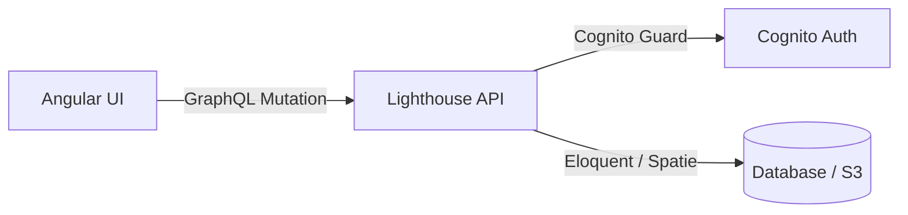

# Feature: {{feature_name}}

> [!SUMMARY] Overview
> **Summary:** {{one_sentence_summary}}  
> **Target Release:** {{target_release}}  
> **Key Stakeholders:** {{stakeholders}}

---

## 1. User Stories & Requirements

### User Stories
- **As a** {{role}},
- **I want to** {{action}},
- **So that** {{benefit}}.

### Acceptance Criteria
- [ ] Criterion 1
- [ ] Criterion 2
- [ ] Criterion 3

---

## 2. Technical Architecture & Data Flow

### Affected Subsystems
- **Backend (API):**
  - Schema: `api/graphql/{{domain}}/*.graphql`
  - Resolvers / Policies: `api/app/GraphQL/`
- **Frontend (UI):**
  - Angular Modules: `ui/src/app/modules/admin/{{module}}`
  - Shared Components / Navigation: `ui/src/app/core/navigation/`

---

## 3. Permissions & Security
- **Required Permission(s):** `{{permission_constant}}`
- **Guards:** `@guard(with: ["cognito"])`
- **Validation Rules:**

---

## 4. Test Scenarios & Edge Cases
> [!IMPORTANT] Edge Cases & Defenses
> - Edge Case 1: {{edge_case_1}}
> - Edge Case 2: {{edge_case_2}}

- [ ] Unit Test Suite: `docker exec core-aairi-api php artisan test --filter={{TestClassName}}`
- [ ] UI Component Test: `npm test`

